# Serverless – Guia de Transporte do Rota Vital

Atividade individual 1 (Serverless) · Infraestrutura de Software · ADS · CESAR School · 2026.2

Função HTTP que recebe uma requisição de bolsas de sangue do Rota Vital e devolve a guia de transporte.

| | |
|---|---|
| **Caminho** | A – AWS SAM CLI local (emula Lambda + API Gateway com Docker) |
| **Onde rodei** | Google Cloud Shell · SAM CLI 1.171.0 · Docker 29.9.3 · Python 3.12.3 |
| **Vídeo** | https://youtu.be/hXN19j9MliY (invocação com evento, HTTP com e sem warm containers, resposta 400 e erro de tempo limite · roteiro em [`ROTEIRO_VIDEO.md`](ROTEIRO_VIDEO.md)) |

## Resumo dos resultados

| Item | Resultado | Evidência |
|---|---|---|
| Invocação com evento (2×) | HTTP 201, guia `G-R-001` · 3,57 s e 3,97 s | [03](evidencias/03-invoke.png) |
| HTTP sem `--warm-containers` | contador **1, 1, 1** · 1,49 s / 0,87 s / 0,83 s | [04](evidencias/04-start-api.png) · [05](evidencias/05-curl-sem-warm.png) |
| HTTP com `--warm-containers LAZY` | contador **1, 2, 3** · 1,08 s / 0,038 s / 0,037 s | [06](evidencias/06-curl-warm-lazy.png) |
| Pedido sem `requisicaoId` | HTTP **400** `requisicaoId obrigatório` | [07a](evidencias/07a-resposta-400-curl.png) · [07b](evidencias/07b-resposta-400-servidor.png) |
| `"demorar": true` com `Timeout: 3` | HTTP **502** em 3,14 s · `timed out after 3 seconds` | [08a](evidencias/08a-timeout-3s.png) · [08b](evidencias/08b-timeout-servidor.png) |
| Mesmo pedido com `Timeout: 10` | HTTP **201** em 5,04 s | [09](evidencias/09-timeout-10s.png) |

**Ajuste no código do enunciado:** o SAM CLI 1.171 gera o evento com o body em base64 (`"isBase64Encoded": true`),
e o `json.loads(body)` original quebrava com `JSONDecodeError`. O [`app.py`](guia_transporte/app.py) decodifica o
base64 antes de ler o JSON e devolve 400 se o body não for JSON válido.

## 1. Arquivos

| Arquivo | Conteúdo |
|---|---|
| [`template.yaml`](template.yaml) | Função, rota `POST /guias`, `Timeout: 3`, 128 MB |
| [`guia_transporte/app.py`](guia_transporte/app.py) | Handler (`lambda_handler`) |
| [`events/`](events/) | Eventos do API Gateway: `pedido.json`, `pedido_invalido.json` (400), `pedido_demorar.json` |
| [`scripts/chamadas.sh`](scripts/chamadas.sh) | As 3 chamadas `curl` do Passo 4 |
| [`tests/test_app.py`](tests/test_app.py) | 5 testes do handler (`python -m pytest -q`) |

## 2. Como rodar

Pré-requisitos: [Docker](https://docs.docker.com/get-started/get-docker), [AWS SAM CLI](https://docs.aws.amazon.com/serverless-application-model/latest/developerguide/install-sam-cli.html)
e Python 3.12. No Windows, use Git Bash ou WSL. Sem instalar nada: no [Google Cloud Shell](https://shell.cloud.google.com),
rode `pip install aws-sam-cli` e use `sam build --use-container`.

Projeto criado com `sam init` (Hello World, Python 3.12, zip): rota trocada de `GET /hello` para `POST /guias` e
pasta `hello_world` renomeada para `guia_transporte`.

**Passo 2 – build**

```bash
git clone https://github.com/egs3-coder/Serverless.git && cd Serverless
sam build
```

**Passo 3 – invocar com evento (2 vezes)**

```bash
time sam local invoke -e events/pedido.json
```

O evento foi gerado com
`sam local generate-event apigateway aws-proxy --method POST --path guias --body '{"requisicaoId":"R-001","hospital":"H-Recife","bolsas":["O-NEG-0142"]}'`.

**Passo 4 – HTTP** (terminal 1 = servidor, terminal 2 = chamadas)

```bash
# terminal 1
sam local start-api
# terminal 2
bash scripts/chamadas.sh

# terminal 1: Ctrl + C e depois
sam local start-api --warm-containers LAZY
# terminal 2
bash scripts/chamadas.sh

# terminal 2: pedido sem requisicaoId → 400
curl -X POST http://127.0.0.1:3000/guias -H "Content-Type: application/json" -d '{"hospital":"H-Recife"}'
```

**Passo 5 – limite de tempo**

```bash
# terminal 2, com Timeout: 3 → 502
curl -X POST http://127.0.0.1:3000/guias -H "Content-Type: application/json" -d '{"requisicaoId":"R-003","demorar":true}'

# trocar para Timeout: 10 no template.yaml, rodar sam build, subir o start-api e repetir o curl → 201
```

## 3. Respostas

### 1. Por que a primeira invocação demorou mais que a segunda? O que acontece na fase de Init?

A primeira invocação é mais lenta porque ocorre o cold start. Essa preparação é a fase de Init: a plataforma
cria o ambiente, carrega o código, inicializa o Python e executa os imports e variáveis globais antes do handler.

Nas chamadas seguintes, o ambiente já está quente e é reutilizado, tornando-as mais rápidas. No teste com
`start-api --warm-containers LAZY`, a primeira chamada demorou 1,08 s e as seguintes cerca de 0,04 s. Já com
`sam local invoke`, cada execução cria um novo container, por isso ambas tiveram tempos semelhantes
(3,57 s e 3,97 s).

**Por que o emulador local não reproduz o cold start real.** No meu print das invocações, a linha `REPORT`
mostra `Init Duration: 0.09 ms` e `0.05 ms`, praticamente zero. Ou seja, o emulador quase não mede a fase de
Init. Os cerca de 3,5 s do tempo `real` são outra coisa: é o Docker criando e subindo o container a cada
`sam local invoke`, além de montar a pasta do código. Isso não existe desse jeito na nuvem, onde a AWS usa
microVMs (Firecracker), baixa o pacote da função e inicializa o runtime, e reaproveita o ambiente nas chamadas
seguintes. Por isso o SAM local serve para ver o comportamento (container novo × reaproveitado, estado, timeout),
mas não para medir o cold start de verdade. Para isso seria preciso rodar no Lambda real e olhar o
`Init Duration` nos logs do CloudWatch.

### 2. O que o campo `invocacaoNesteAmbiente` mostrou com e sem `--warm-containers`? O que isso diz sobre guardar estado numa variável global?

Sem `--warm-containers`, o resultado foi sempre `1`, porque cada requisição criava um novo container e
reiniciava o contador.

Com `--warm-containers LAZY`, os valores foram `1, 2, 3`, pois o mesmo container foi reutilizado e manteve a
variável global na memória.

Mesmo assim, variáveis globais não são confiáveis para armazenar dados permanentes: o ambiente pode ser
encerrado, e requisições simultâneas podem usar containers diferentes. Para informações importantes, como a
quantidade de guias emitidas, é melhor usar um armazenamento externo, como DynamoDB, um banco de dados
relacional ou Redis. Variáveis globais são mais adequadas para caches, como uma conexão com o banco de dados.

### 3. O que aconteceu com `demorar = true`? Qual o tempo máximo de uma execução no Lambda, e o que fazer com um trabalho mais longo?

Com `Timeout: 3`, a função precisava de 5 segundos, mas foi interrompida aos 3. O `curl` recebeu o erro
HTTP `502 – Internal server error`, e o log do SAM mostrou: `timed out after 3 seconds`. Por isso, a guia não
foi emitida. Após aumentar o limite para 10 segundos e executar o `sam build` novamente, a chamada respondeu
`201` depois de aproximadamente 5 segundos.

O AWS Lambda permite execuções de até 15 minutos. Para tarefas mais longas, pode-se dividi-las em etapas,
usar Step Functions ou SQS, ou recorrer a serviços como ECS/Fargate e AWS Batch.

**Tempo total ou tempo de CPU?** No Lambda o limite é de **tempo total** (wall-clock): conta o tempo do
início ao fim da execução, inclusive quando a função está parada esperando. O meu próprio teste mostra isso:
o `time.sleep(5)` praticamente não usa CPU, e mesmo assim a função foi encerrada aos 3 segundos. A cobrança
também segue o tempo total (`Billed Duration: 3000 ms` no log).

**Comparação com o Cloudflare Workers.** Lá a lógica é outra: o limite de uma requisição HTTP é de **tempo de
CPU** (10 ms no plano gratuito; 30 s por padrão no pago, configurável até 5 min). O tempo esperando rede ou banco
não conta, e não há limite de tempo total enquanto o cliente continua conectado. Se a mesma função com
`sleep` rodasse no Workers, ela não estouraria o limite, porque dormir não gasta CPU. Já um cálculo pesado
estouraria muito antes lá do que no Lambda.

**Atualização (19/11/2026):** a AWS anunciou que as *Event Functions* sob demanda podem rodar até 30 minutos;
as *Web Functions* continuam com 15. O valor de 15 minutos é o da aula e o que vale para uma função web como esta.

### 4. Quanto custam 1 milhão de execuções com 128 MB e 100 ms?

Na região `us-east-1`, o custo estimado para 1 milhão de execuções é:

**Requisições:**
`1.000.000 × (US$ 0,20 ÷ 1.000.000) = US$ 0,20`

**Computação:**

- Memória: `128 MB ÷ 1024 = 0,125 GB`
- Por execução: `0,125 GB × 0,1 s = 0,0125 GB-s`
- 1 milhão de execuções: `0,0125 × 1.000.000 = 12.500 GB-s`
- Custo: `12.500 × US$ 0,0000166667 ≈ US$ 0,21`

O GB-s combina a memória usada pela função com o tempo de execução: é a quantidade de GB multiplicada pelo
número de segundos.

**Custo total:**
`US$ 0,20 + US$ 0,21 ≈ US$ 0,41`

Como esse volume está dentro da faixa sempre gratuita do AWS Lambda — 1 milhão de requisições e 400 mil GB-s
por mês — o custo seria zero.

### 5. Em que parte do Rota Vital uma função assim faria sentido, e em qual não faria?

O AWS Lambda faz sentido no Rota Vital para tarefas curtas, sem estado e acionadas por eventos, como:

- gerar a guia quando um hospital solicitar bolsas de sangue;
- avisar o hospital quando a bolsa sair do hemocentro;
- criar o PDF ou QR Code da guia;
- receber webhooks e validar pedidos.

Como o volume de requisições varia, pagar por execução pode ser mais barato do que manter um servidor ligado.

Não é indicado para:

- rastrear veículos em tempo real, com conexão contínua;
- executar otimizações de rotas ou relatórios que durem mais de 15 minutos;
- armazenar informações importantes na memória entre chamadas;
- processos críticos que não podem sofrer com o cold start, como uma emergência. Nesse último caso, seria
  necessário usar concorrência provisionada, que mantém ambientes prontos para reduzir esse atraso.

## 4. Evidências

Prints do Google Cloud Shell, em ordem de execução. A lista também está em [`evidencias/README.md`](evidencias/README.md).

**01 – ferramentas instaladas**

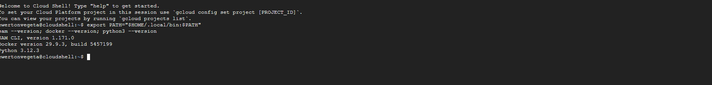

**02 – `sam build`** (Build Succeeded)

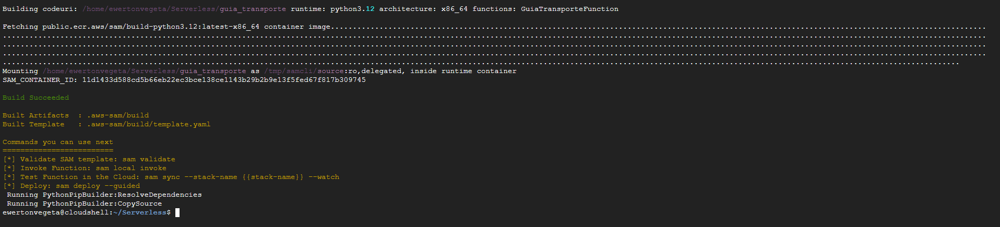

**03 – duas invocações com evento** (201, linha `REPORT` e tempo `real`)

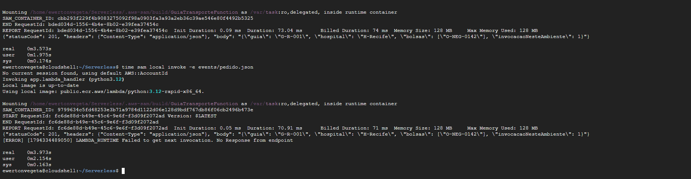

**04 – `sam local start-api`** (rota `POST /guias`)

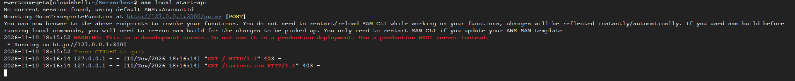

**05 – 3 chamadas sem `--warm-containers`** (contador 1, 1, 1)

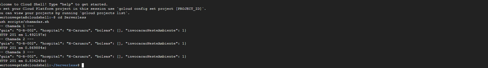

**06 – 3 chamadas com `--warm-containers LAZY`** (contador 1, 2, 3)

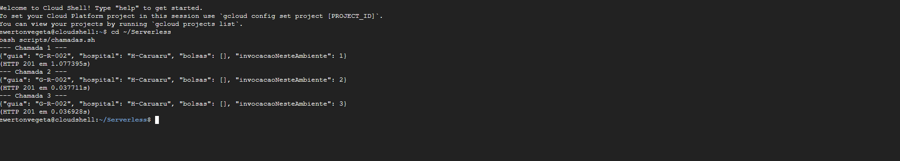

**07a – pedido sem `requisicaoId`** (HTTP 400)

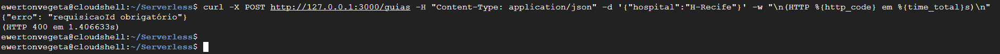

**07b – log do SAM** (`"POST /guias HTTP/1.1" 400`)

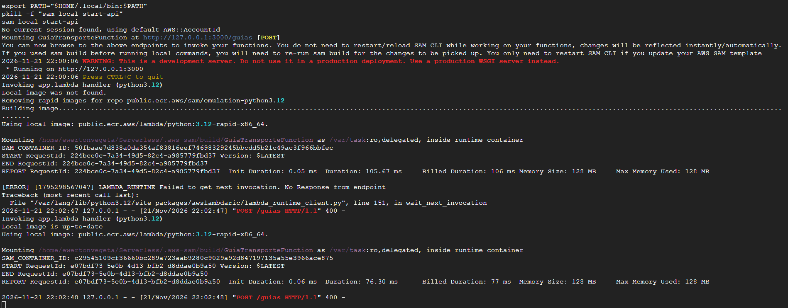

**08a – `"demorar": true` com `Timeout: 3`** (HTTP 502 em 3,14 s)

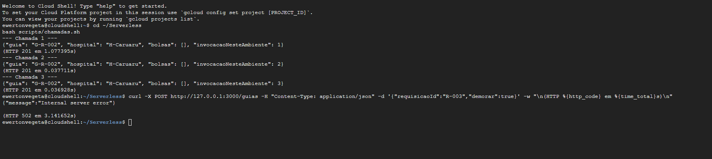

**08b – log do SAM** (`timed out after 3 seconds`, `Duration: 3000.00 ms`)

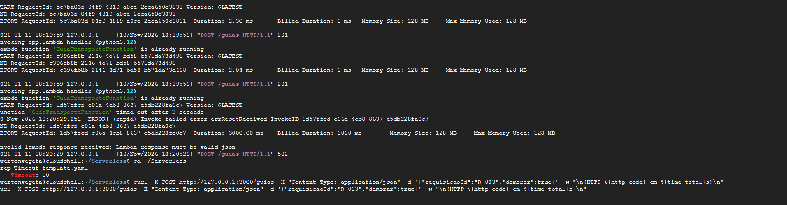

**09 – com `Timeout: 10`** (HTTP 201 em 5,04 s)

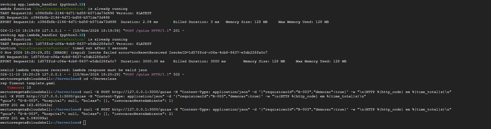

## 5. Uso de IA

Declaração conforme a PO-CESAR-021.

- **Ferramenta:** Claude (Anthropic).
- **Finalidade:** montar a estrutura do projeto SAM (template, eventos, script de chamadas e testes); ajustar o
  handler para ler o body em base64; redigir o README e o rascunho das respostas; me orientar na execução pelo
  Google Cloud Shell e no roteiro de fala do vídeo; depois do retorno do professor, redigir os complementos das
  respostas 1 e 3 (emulador × cold start real, tempo total × CPU, comparação com o Cloudflare Workers) e
  organizar o teste da resposta 400.
- **Como validei:** executei eu mesmo todos os comandos no Google Cloud Shell (prints em `evidencias/`) e gravei
  o vídeo; conferi as respostas da função, os tempos, o contador e o timeout; rodei `python -m pytest`
  (5 testes passando) e `sam validate --lint`; refiz a conta de custo à mão; reescrevi as respostas com as minhas
  palavras e revisei os complementos com o material da Aula 007 e as documentações da AWS e da Cloudflare.
  Todos os números são das minhas execuções.

## 6. Referências

- Ciclo de vida do ambiente de execução do Lambda: https://docs.aws.amazon.com/lambda/latest/dg/lambda-runtime-environment.html
- Cotas do Lambda: https://docs.aws.amazon.com/lambda/latest/dg/gettingstarted-limits.html
- Preços do Lambda: https://aws.amazon.com/lambda/pricing
- Limites do Cloudflare Workers: https://developers.cloudflare.com/workers/platform/limits/
- Timeout de 30 minutos para Event Functions (AWS, 19/11/2026): https://aws.amazon.com/blogs/compute/announcing-30-minute-timeout-for-on-demand-aws-lambda-event-functions/
